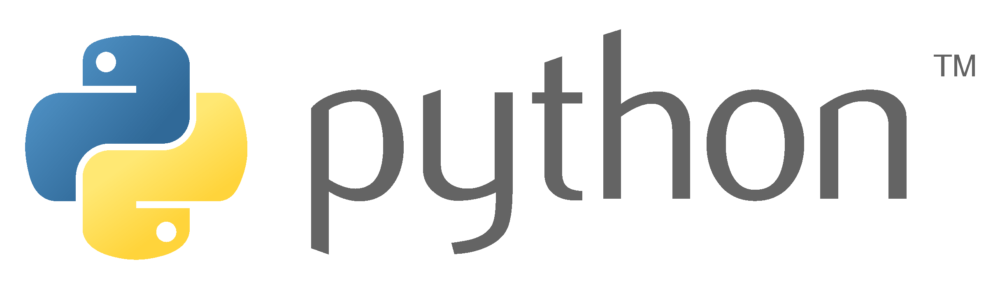

# <a name="execute-wf"></a>Execute workflow through python script

<div align="center"></div>

This workflow can be executed through a python script in two different ways:

* **[A. Conda mode](#conda-mode):** a conda environment provides the biobb python packages **and** all the third-party tools they wrap (GROMACS, AmberTools, Open Babel...), installed on your computer.
* **[B. Container mode](#container-mode):** only the biobb python packages are installed (with **pip**). Every step that needs a third-party tool runs it inside a **Docker** or **Singularity** container that is downloaded automatically. Steps written in pure python run directly on your computer, this is why the biobb packages are still needed.

Use **conda mode** if you prefer to have everything installed locally. Use **container mode** if you want to skip the conda installation of the tools, or to run exactly the same tool builds used by the [BioContainers](https://biocontainers.pro/) images.

## <a name="files"></a>Workflow files

Below you can find the list of all the needed **files** for executing this workflow:

* **workflow.py:** the python file with all the steps to execute this workflow (the same file for both modes).
* **workflow.yml:** the configuration file with the I/O dependencies and settings for each step of the workflow (conda mode).
* **workflow.env.yml:** the environment file needed for create a conda environment where this workflow will be run (conda mode).
* **requirements.txt:** the list of biobb python packages to install with pip (container mode).
* **workflow.docker.yml:** same as **workflow.yml**, plus the Docker image for every step that runs a third-party tool (container mode).
* **workflow.singularity.yml:** same as **workflow.yml**, plus the Singularity image for every step that runs a third-party tool (container mode).
* **inputs:** the inputs vary depending on the workflow, all the needed files are available in this same repository, just be sure to have them in the same folder where **workflow.yml** is.

The BioBB's are fully compatible with **Linux** and **macOS**. For running them on **Windows 10**, you should do it through the Windows Subsystem for Linux. In the BioBB official website, [there is a tutorial](https://mmb.irbbarcelona.org/biobb/availability/tutorials/windows) explaining how to do it.

## <a name="conda-mode"></a>A. Conda mode

### <a name="requirements"></a>Requirements

For executing a BioBB workflow in conda mode, there is a single requirement: to have [Anaconda](https://docs.anaconda.com/anaconda/install/index.html) installed in your computer. Once this requirement is fullfilled, you will be able to install the workflow.

### <a name="installation"></a>Installation

After downloading the workflow files and decompressing them in a folder, please go to this directory, open it in terminal and execute the following script:

    conda env create --file workflow.env.yml

This process can take a while, and once it is finished you will have an environment with **all the dependencies** needed for running this workflow. For activate this environment, please follow the instructions given by the conda installator. Just before finishing the installation, the terminal will prompt the following message:

```shell
#
# To activate this environment, use
#
#     $ conda activate biobb_wf_dna_helparms
#
# To deactivate an active environment, use
#
#     $ conda deactivate
```

So execute the following script:

    conda activate biobb_wf_dna_helparms

### <a name="run-wf"></a>Run workflow

After that, the only thing left is to run the workflow:

    python workflow.py --config workflow.yml

Take into account that depending on the number of steps, the tools executed and the settings provided, along with the power of your computer, the execution of the workflow can take from a **few minutes** to **several hours**. The workflow progress will be shown in your terminal.

## <a name="container-mode"></a>B. Container mode

### <a name="container-requirements"></a>Requirements

* **Python 3** with **pip** (the `venv` module is used below to keep the packages isolated).
* One container engine:
    * **Docker**: the Docker daemon must be running and your user must be allowed to run `docker` commands (`docker run hello-world` should work). On macOS and Windows, use [Docker Desktop](https://docs.docker.com/desktop/).
    * **Singularity / Apptainer**: usual on HPC clusters, where Docker is often not available.

Notes about the platform:

* The images are built for **linux/amd64**. On Linux they run natively. On macOS with Apple Silicon (M1/M2/...), Docker Desktop runs them under emulation, which works but is noticeably slower.
* On Windows, use WSL2 together with Docker Desktop.

### <a name="container-installation"></a>Installation

After downloading the workflow files and decompressing them in a folder, please go to this directory, open it in terminal and execute the following script:

    python3 -m venv .venv
    source .venv/bin/activate
    pip install -r requirements.txt

Only the biobb python packages are installed, so it takes much less than the conda installation. Keep the virtual environment **activated** when running the workflow: some steps call command-line tools installed by these packages (e.g. `check_structure`), and the activation puts them on your `PATH`.

### <a name="container-run-docker"></a>Run workflow with Docker

    python workflow.py --config workflow.docker.yml

The first time, every Docker image used by the workflow is downloaded, which can add several GB and some minutes to the first execution. The next executions reuse them.

**Linux only:** by default the containers run as the image user, so the files they create do not belong to you and some steps fail with a `PermissionError` when processing them. To avoid it, add your user and group ids (the output of `id -u` and `id -g`) to the `global_properties` section of **workflow.docker.yml**:

```yaml
global_properties:
  container_user_id: "1000:1000"   # replace with the output of: echo "$(id -u):$(id -g)"
```

This is not needed with Docker Desktop on macOS or Windows.

### <a name="container-run-singularity"></a>Run workflow with Singularity

The containers run as your own user, so no extra setting is needed.

**Download the images first.** The current biobb releases cannot download a Singularity image from a URL by themselves (the name given to the downloaded file is wrong; the fix comes with the next biobb release). Until then, download the images once to a local folder and run the workflow with a copy of **workflow.singularity.yml** that points to them:

```shell
mkdir -p sif
# download every image used by the workflow (only once)
for url in $(grep -oE 'https://depot.galaxyproject.org/singularity/[^ ]+' workflow.singularity.yml | sort -u); do
    singularity pull --dir sif --name "$(basename "$url" | tr ':' '_').sif" "$url"
done
# copy of the configuration pointing to the local images
sed -E "s|container_image: https://depot.galaxyproject.org/singularity/([^: ]+):([^ ]+)|container_image: $PWD/sif/\1_\2.sif|" \
    workflow.singularity.yml > workflow.singularity.local.yml
```

Then run the workflow:

    python workflow.py --config workflow.singularity.local.yml

### <a name="container-notes"></a>Notes for this workflow (container mode)

* **A `/data` folder on your computer.** The Curves+ / Canal steps change the working directory to `/data` (the folder where the files are mounted *inside* the container) also on your computer, so it must exist there:

    ```shell
    sudo mkdir -p /data
    ```

    It can stay empty: the containers use their own `/data`.

## <a name="get-output"></a>Get output results

Once the workflow is finished, you just should enter the new **wf_python/biobb_wf_dna_helparms** folder and, inside it, you will find a folder for each step of the workflow with all the files generated in every step.

## <a name="tests"></a>Tests

### Conda mode

To run the tests for this workflow, the **pytest framework** must be installed into the environment described in the [**Installation**](#installation) section:

    conda install conda-forge::pytest

Once the pytest framework is installed, please go to the [**python tests folder**](../tests/python) and execute:

    pytest biobb_wf_dna_helparms.py --config ../../python/workflow.yml --remove

To disable the output capturing and show all the logs for each step, please add the **-s** flag:

    pytest -s biobb_wf_dna_helparms.py --config ../../python/workflow.yml --remove

If you want to preserve all the temporary files generated during the tests, just remove the **--remove** flag:

    pytest biobb_wf_dna_helparms.py --config ../../python/workflow.yml

### Container mode

Please go to the [**python tests folder**](../tests/python) and execute one of:

    bash run_container_test.sh docker
    bash run_container_test.sh singularity

The script creates its own temporary virtual environment from **requirements.txt** (plus pytest), shortens the MD steps so the test runs fast, and removes everything at the end. Set `FULL_STEPS=1` to run the full-length steps and `KEEP=1` to keep the temporary files.
